Distributed BMS for a 60 V Lead-Acid EV
=======================================

Battery management system for a light four-wheel electric vehicle, built around a
**distributed master–slave architecture**: one monitor board bolted to each battery,
all reporting over a galvanically isolated CAN bus to a central controller that owns
the contactor.

Undergraduate capstone project, Ho Chi Minh City University of Technology (HCMUT).
Hardware was built and measured on the bench — see [VII. Limitations](#vii-limitations)
for what was *not* proven.

| | |
|---|---|
| **Pack** | 5 × CSB EVX12200 (12 V / 20 Ah VRLA-AGM) in series = 60 V |
| **Load** | 4 × BLDC motors, ≈100 A peak (5C) |
| **Battery monitor** | 5 × STM32F103C8T6, one per battery, galvanically isolated |
| **Central controller** | ESP32 (dual-core, FreeRTOS) |
| **Buses** | 2 × CAN 2.0A @ 500 kbit/s, electrically separate · Wi-Fi AP |
| **Own code** | ≈6 200 lines of C / C++ (excludes vendor HAL) |

---

I. Introduction
---------------

Five batteries in series: the **weakest one** sets the discharge limit of the whole
pack. Measuring only across the string hides that — the total can look healthy while
one battery is already below its cut-off, and the imbalance accumulates over time.

This BMS puts a monitor board at each battery's terminals. Each one measures its own
battery's voltage and temperature, runs a Kalman filter to estimate that battery's
state of charge, and reports over CAN. A central controller collects all five, measures
pack current through a shunt, and opens the contactor when any safety condition fails.

<p align="center">
  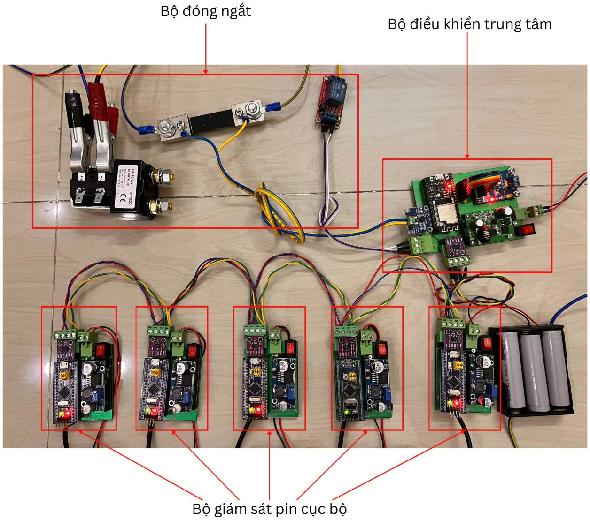
</p>

_Figure 1: Complete battery management system — contactor unit (top left), central
controller (top right), five battery monitors (bottom)_

<p align="center">
  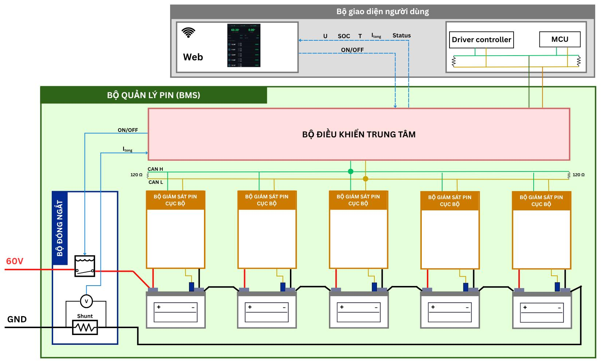
</p>

_Figure 2: System block diagram — five battery monitors on the internal CAN bus, one
central controller, contactor and shunt on the power path_

---

II. System design
-----------------

### 2.1 Why distributed

A centralised design runs one sense wire per battery back to a single board: long
noise-prone wires, six different potentials landing on one PCB, and a redesign every
time the pack size changes.

The distributed design puts a monitor at each battery's terminals — sense wires a few
centimetres long, one extra CAN node per extra battery, and per-battery diagnosis for
free. The cost is more components and more boards, which is acceptable at five
batteries.

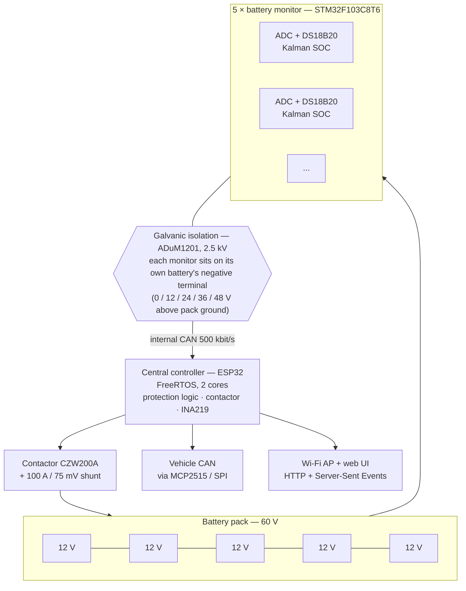

### 2.2 The problem that creates, and the fix

Each monitor's measurement ground is the **negative terminal of its own battery**, so
the five boards sit at 0 / 12 / 24 / 36 / 48 V relative to pack ground — six reference
domains sharing one CAN bus. Bonding them to a common ground would short four batteries
through the signal wiring.

Each monitor is therefore split by an **ADuM1201 digital isolator** (2.5 kV) placed
between the MCU and the CAN transceiver: only TX and RX cross the boundary. Power is
split the same way — the floating side runs off the battery it measures, the bus side
takes +5 V from the central controller. Voltage divider and temperature sensor stay
entirely inside the floating domain, so no conductive path crosses the barrier.

<p align="center">
  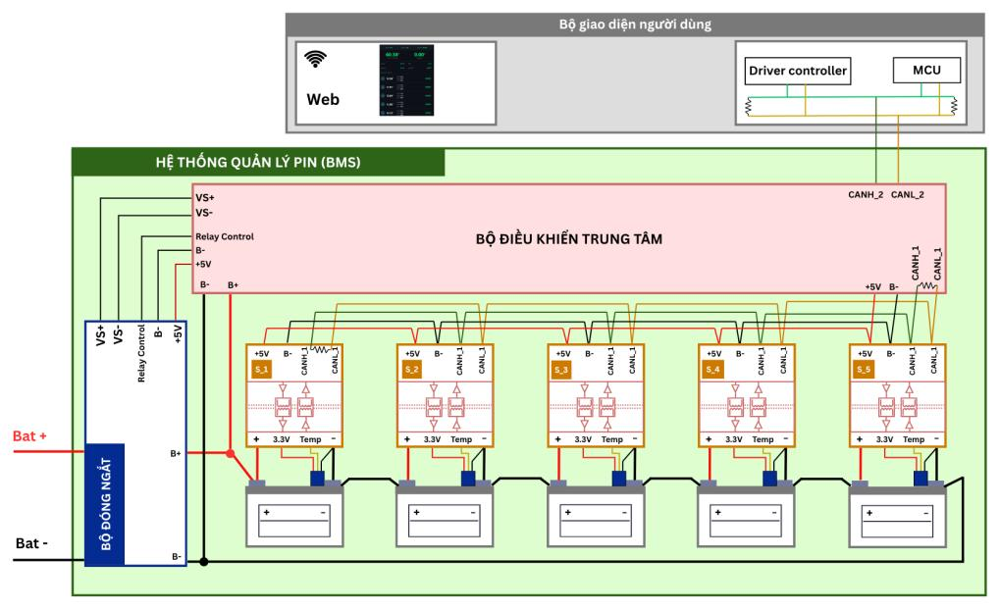
</p>

_Figure 3: System wiring — the isolation boundary runs through each monitor S_1…S_5.
Below it, the floating domain tied to one battery; above it, the shared-ground domain
carrying +5 V and the CANH_1 / CANL_1 pair_

---

III. Hardware design
--------------------

### 3.1 Battery monitor (×5)

| Function | Part | Key spec |
|---|---|---|
| Step-down supply | LM2596HV | input to 60 V, 3 A out |
| MCU | STM32F103C8T6 | Cortex-M3 72 MHz, 12-bit ADC, bxCAN |
| Signal isolation | ADuM1201 | 2 channels opposing, 2.5 kV |
| CAN transceiver | MCP2551 | to 1 Mbit/s, 112 nodes |
| Temperature | DS18B20 | 1-Wire, ±0.5 °C over −10…85 °C |
| Voltage sense | 33 kΩ / 9.1 kΩ divider | ratio 0.2162 → 15.27 V at ADC full scale |

The divider ratio puts the 15.00 V over-voltage threshold at 3.24 V on a 3.3 V ADC —
inside range, with the full scale only 0.27 V above the trip point.

<p align="center">
  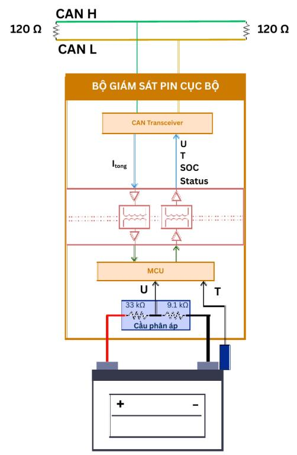
</p>

_Figure 4: Battery monitor block diagram — the isolator sits between MCU and CAN
transceiver, so each board's ground stays independent of the bus_

<p align="center">
  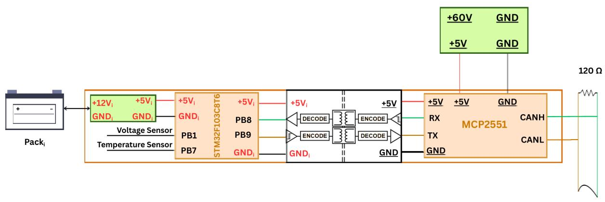
</p>

_Figure 5: Battery monitor wiring. PB1 reads the divider, PB7 the DS18B20, PB8/PB9
cross the isolator to the transceiver_

<p align="center">
  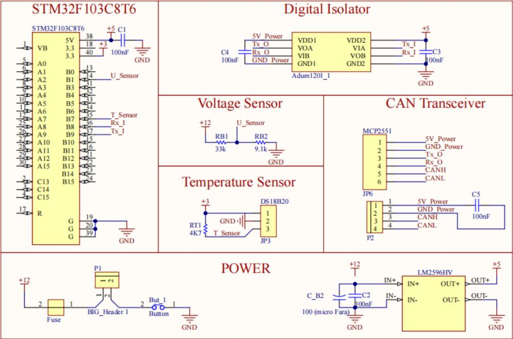
</p>

_Figure 6: Battery monitor schematic — MCU, digital isolator, voltage sense,
temperature sense, CAN transceiver, power_

<p align="center">
  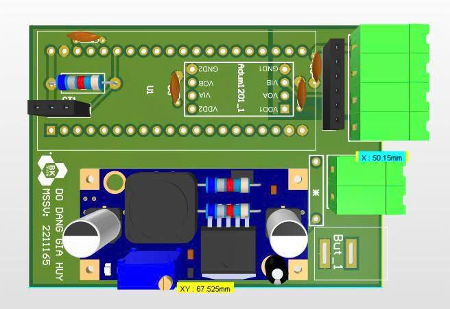
  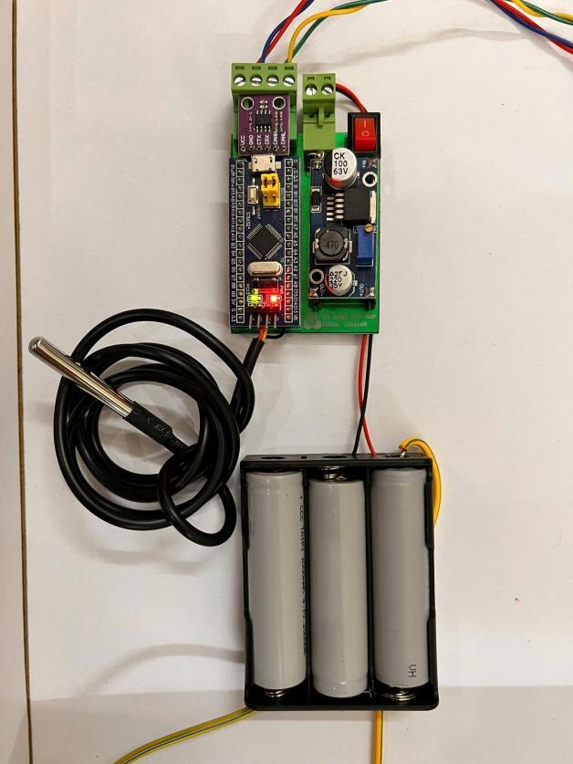
</p>

_Figure 7–8: Battery monitor PCB layout (67.5 × 50.2 mm) and the assembled board_

### 3.2 Central controller

| Function | Part | Key spec |
|---|---|---|
| Step-down supply | Buck 5 V / 3 A | 9–90 V in, 140 kHz, thermal + short protection |
| MCU | ESP32 | dual-core, TWAI (CAN 2.0B), Wi-Fi |
| Internal CAN transceiver | MCP2551 | to 1 Mbit/s |
| Vehicle CAN controller | MCP2515 | standalone CAN 2.0B over SPI, 8 MHz crystal |
| Current sensor | INA219 | 12-bit, ±427 A on a 0.75 mΩ shunt, 13.3 mA step, ±1.5 % total |

The ESP32 has exactly one TWAI peripheral and the internal bus already uses it, so the
vehicle bus needs a second controller — hence the MCP2515 over SPI.

<p align="center">
  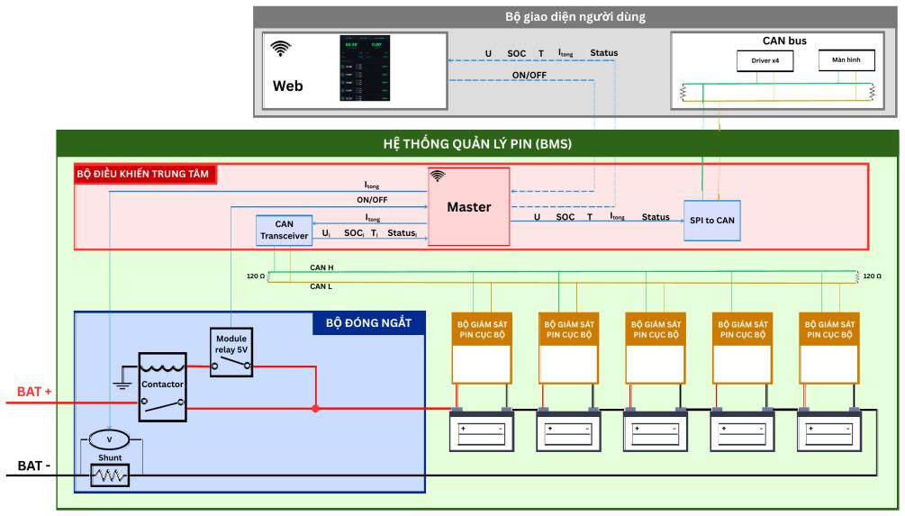
</p>

_Figure 9: Central controller block diagram_

<p align="center">
  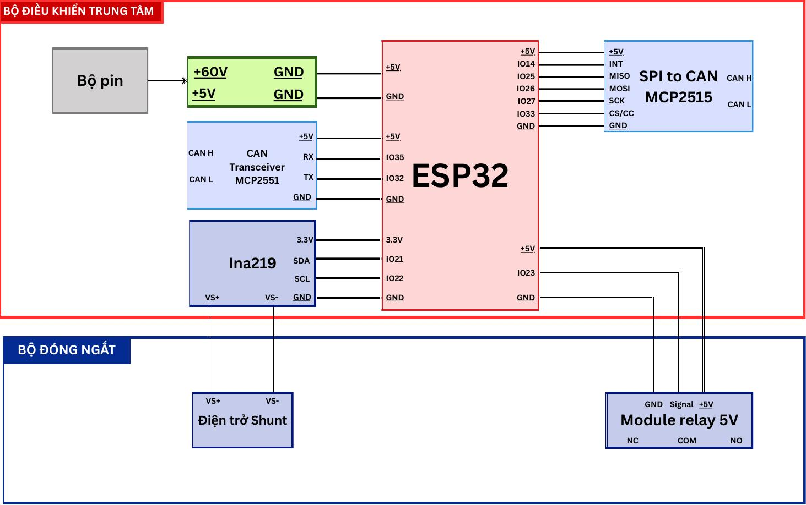
</p>

_Figure 10: Central controller wiring — MCP2551 on IO35/IO32, INA219 on I²C IO21/IO22,
MCP2515 on SPI IO25/26/27/33 with interrupt on IO14, relay drive on IO23_

<p align="center">
  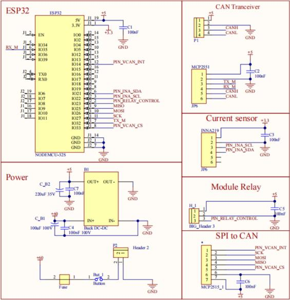
</p>

_Figure 11: Central controller schematic — ESP32, CAN transceiver, current sensor,
relay module, SPI–CAN, power_

<p align="center">
  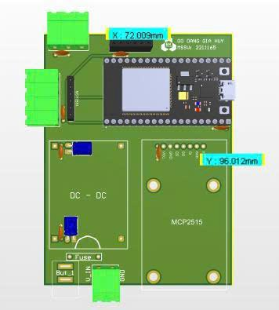
  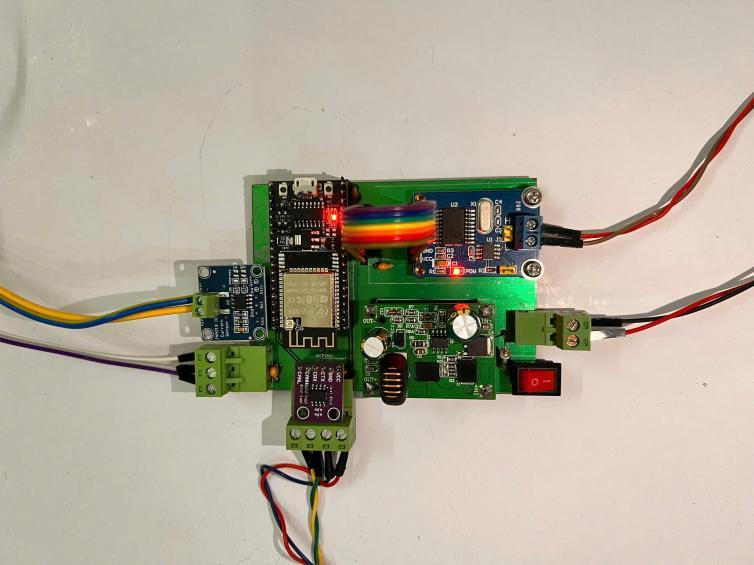
</p>

_Figure 12–13: Central controller PCB layout (72 × 96 mm) and the assembled board_

### 3.3 Current sensing

A **100 A / 75 mV shunt (0.75 mΩ)** sits on the pack **negative** terminal. High-side
is not an option: the INA219 common-mode range stops at 26 V and the pack is 60 V.

PGA ÷8 gives ±320 mV = **±427 A** with a 13.3 mA step. The over-current threshold has
to fall inside the measurement range, and a narrower PGA setting would make
over-current protection silently unreachable.

---

IV. Software design
-------------------

### 4.1 CAN frame design

Two electrically separate CAN networks, both 500 kbit/s. Every signal is
`raw × gain + offset`, MSB first.

<p align="center">
  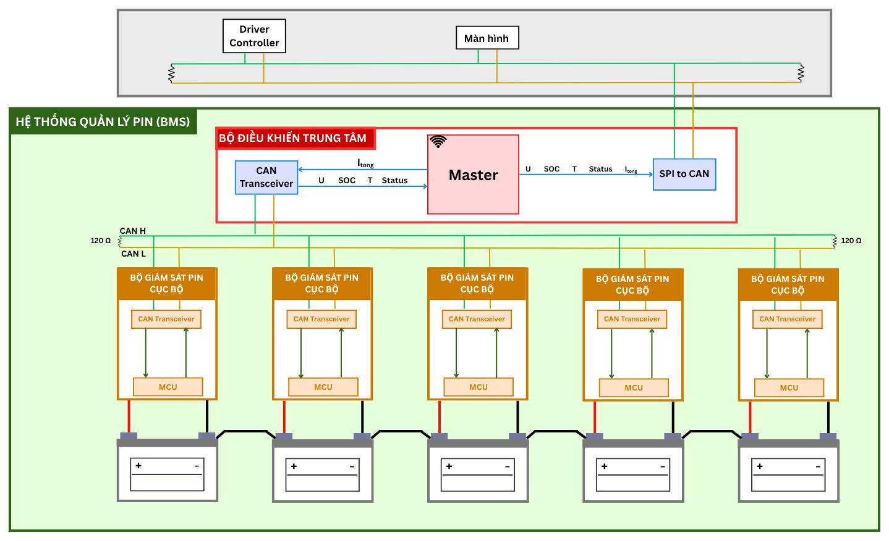
</p>

_Figure 14: CAN topology — internal multi-drop bus with 120 Ω at both ends; vehicle bus
transmit-only through the MCP2515_

<p align="center">
  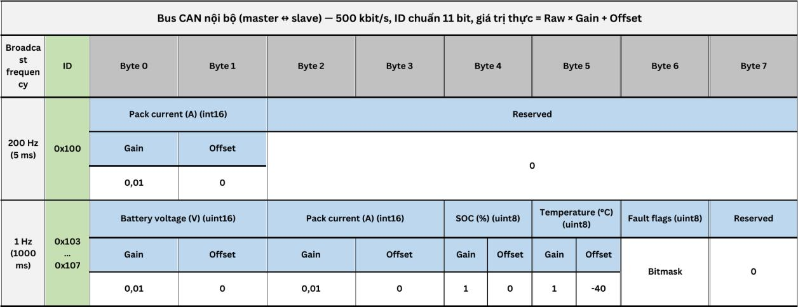
</p>

_Figure 15: Internal bus frames. `0x100` carries pack current downward every 5 ms;
`0x103`–`0x107` carry each battery's voltage, current, SOC, temperature and fault flags
upward every 1000 ms_

<p align="center">
  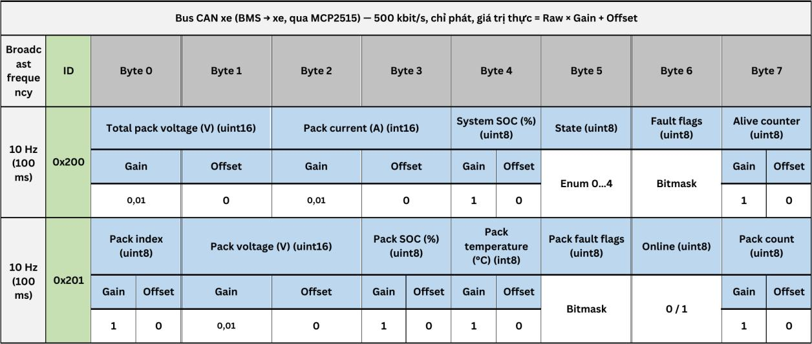
</p>

_Figure 16: Vehicle bus frames. `0x200` carries pack-level state, `0x201` carries
per-battery detail multiplexed one battery per frame — all five scanned in 500 ms_

### 4.2 Timing

The five monitors share a 1000 ms period but are **phase-offset by 100 ms** (first
transmits at 300 ms, then 400 / 500 / 600 / 700). Their frames therefore never collide
with each other. When a monitor's frame does coincide with `0x100`, it loses
arbitration — the master's ID is lower — waits, and transmits immediately after.

<p align="center">
  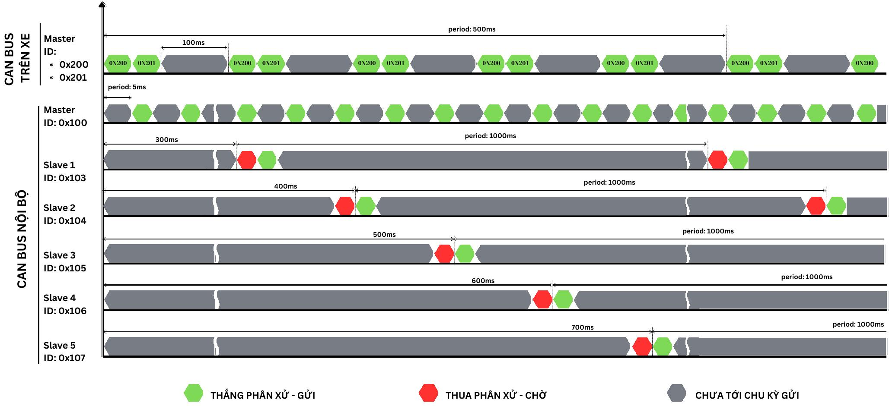
</p>

_Figure 17: Timing of both CAN networks. Green = won arbitration, red = lost and
waiting, grey = not yet due_

<p align="center">
  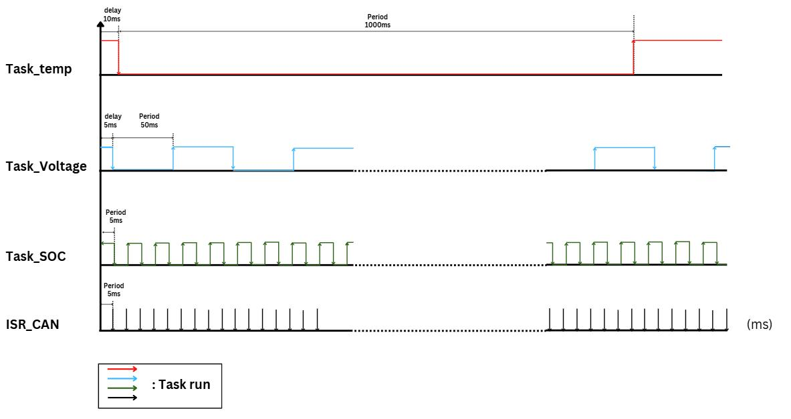
</p>

_Figure 18: Battery monitor task timing — temperature 1000 ms, voltage 50 ms, SOC 5 ms,
CAN receive interrupt 5 ms_

<p align="center">
  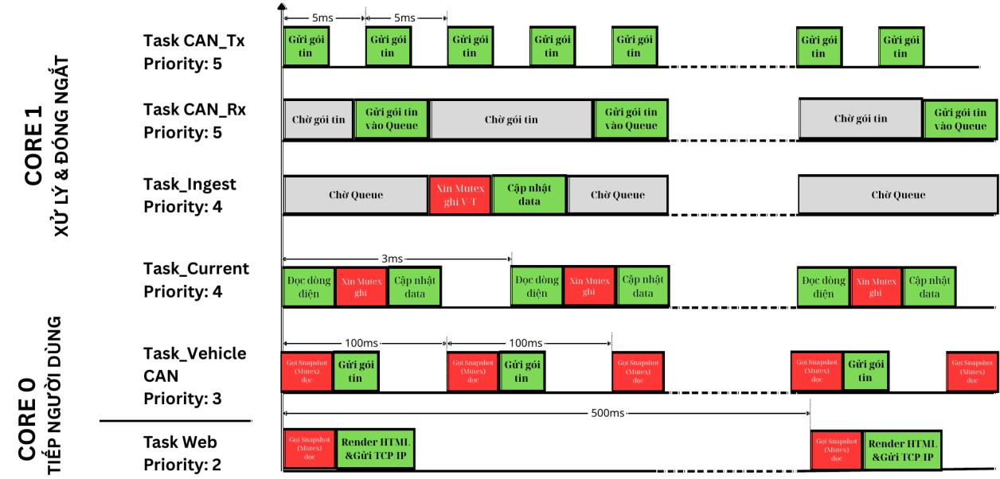
</p>

_Figure 19: Central controller task timing. Core 1 runs the real-time work (CAN TX/RX
priority 5, ingest and current priority 4, vehicle CAN priority 3); core 0 runs the web
server at priority 2_

### 4.3 Data flow

Both microcontrollers use the same shape: producers write into one store, consumers
read a consistent snapshot of it.

<p align="center">
  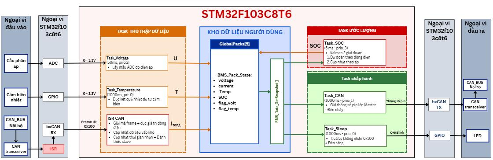
</p>

_Figure 20: Battery monitor data flow. Voltage and temperature tasks and the CAN
interrupt write into the store; the SOC task reads it, runs the filter, writes SOC back;
the CAN task sends a snapshot_

<p align="center">
  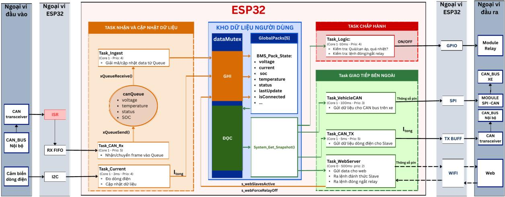
</p>

_Figure 21: Central controller data flow. Every access to the shared store takes
`dataMutex`, and inter-task hand-off goes through `canQueue`_

### 4.4 Protection

<p align="center">
  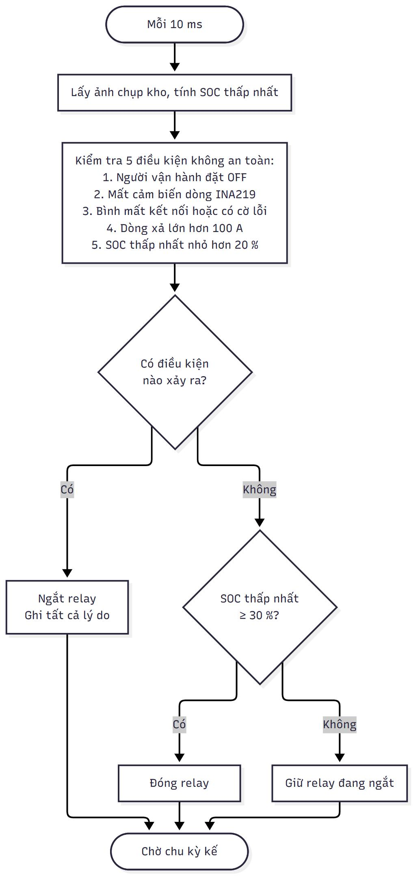
</p>

_Figure 22: Protection task, 10 ms period. Any one unsafe condition opens the relay, and
**all** active reasons are recorded so the web UI can show the complete fault list rather
than only the first one_

The relay starts **open** and never closes on its own: the operator has to command it on
from the web interface, and the safety conditions have to pass as well.

### 4.5 State of charge

A **1-RC equivalent-circuit Kalman filter runs on each STM32**, estimating only its own
battery.

```
OCV(SOC) = 11.63 + 1.26 · SOC          Q = 72 000 A·s (20 Ah)
R0 = 13.5 mΩ, temperature-corrected    R1 = 13.5 mΩ, C1 = 1850 F
```

Multirate: *predict* integrates current every 5 ms against the `0x100` frame, *update*
corrects against the voltage sample every 50 ms. If no `0x100` arrives for 100 ms the
current is forced to zero rather than integrated stale.

The pack SOC reported upward is the **minimum** of the five, and is reported as
*unknown* rather than guessed whenever any monitor is offline.

**Why a filter rather than Coulomb counting** — see [VI. Off-target verification](#vi-off-target-verification).

---

V. Results
----------

All measurements on the bench, with a multimeter, clamp meter, Saleae logic analyser
and PCAN-View.

| Requirement | Target | Measured |
|---|---|---|
| Battery voltage error | < 0.2 V | **0.02 V** |
| Temperature error | within 1 quantisation step | **1 °C** |
| Pack current error | < 5 % of reading | **2.2 %** |
| Fault detected → trip command | < 20 ms | **8.53 ms** |
| `0x100` frame period | 5 ms | 5.0 ms |
| `0x103`–`0x107` frame period | 1000 ms | 1000.1 ms |
| `0x200` / `0x201` frame period | 100 ms | 100.3 ms |
| Monitor tasks (SOC / voltage / CAN / temp) | 5 / 50 / 1000 / 1000 ms | 5.003 / 49.998 / 1000.025 / 1000.025 ms |
| Controller tasks (current / protection / web) | 3 / 10 / 500 ms | 2.95 / 10.00 / 500.04 ms |

### 5.1 Sensor accuracy

<p align="center">
  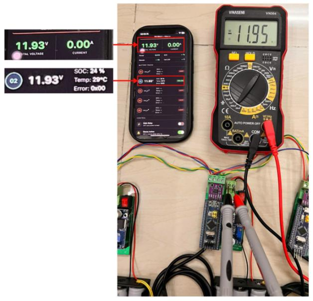
</p>

_Figure 23: Voltage cross-check. The monitor reports 11.93 V, a VN304 multimeter reads
11.95 V on the same terminals — 0.02 V apart_

<p align="center">
  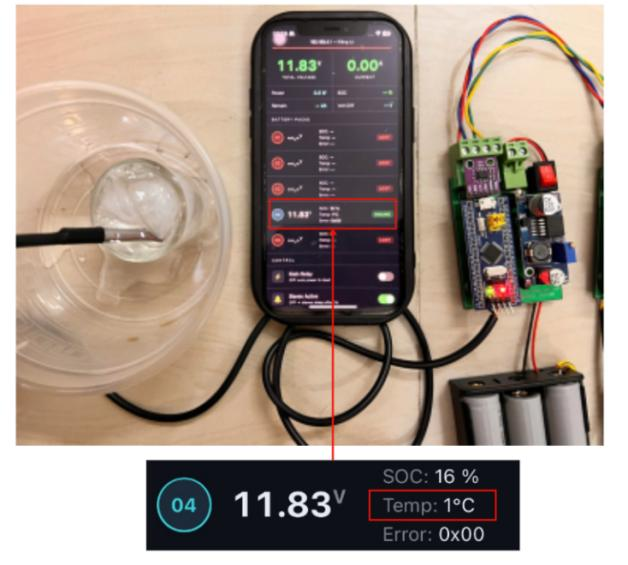
</p>

_Figure 24: Temperature cross-check against melting ice (0.0 °C by definition). The web
UI shows 1 °C — one display step_

<p align="center">
  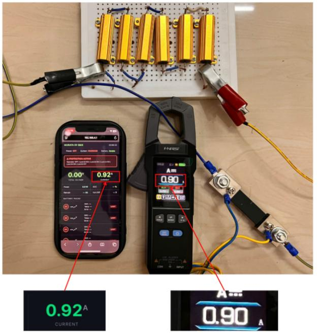
</p>

_Figure 25: Current cross-check on a resistive load. Web shows 0.92 A, clamp meter reads
0.90 A — 2.2 % of reading_

### 5.2 Trip latency

<p align="center">
  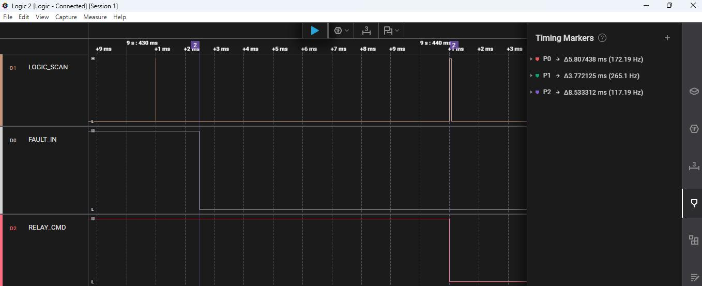
</p>

_Figure 26: Fault-injection input pulled low, contactor command measured on a second
channel: **8.53 ms**, against a 20 ms requirement. The third channel marks every
protection-task scan, which is what sets the latency_

Measured between two GPIO edges with a logic analyser, not reported by the firmware
measuring itself. The figure covers detection → command inside the microcontroller; it
excludes CAN transport, the 3 s node timeout and the contactor's mechanical travel.

### 5.3 Timing verification

Every periodic task raises a GPIO while it runs, so period and jitter are read directly
off the waveform.

<p align="center">
  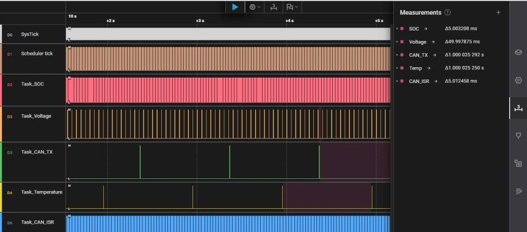
</p>

_Figure 27: Battery monitor task periods — 5.003 / 49.998 / 1000.025 / 1000.025 ms,
within 0.5 % of design_

<p align="center">
  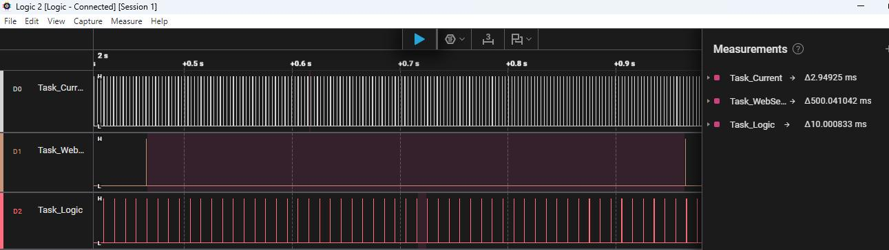
</p>

_Figure 28: Central controller task periods — 2.95 / 10.00 / 500.04 ms, within 2 %_

<p align="center">
  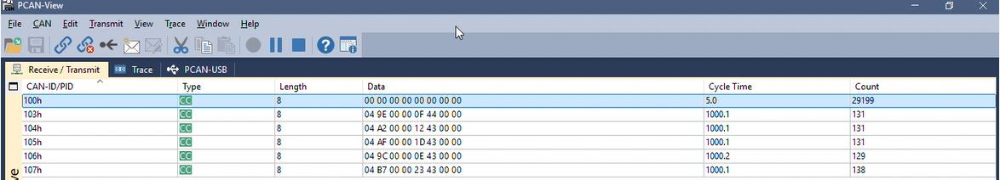
</p>

_Figure 29: Internal bus captured with PCAN-View. `0x100` at 5.0 ms; `0x103`–`0x107` at
1000.1 ms_

<p align="center">
  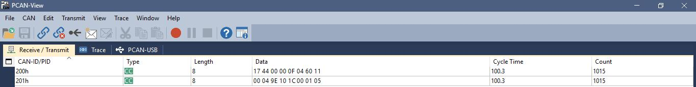
</p>

_Figure 30: Vehicle bus captured with PCAN-View. `0x200` and `0x201`, 8 bytes each, at
100.3 ms_

### 5.4 Web interface

The controller runs a Wi-Fi access point and serves the UI itself — HTTP for the page,
Server-Sent Events for a one-way 500 ms data push, HTTP POST for operator commands. No
external network needed.

<p align="center">
  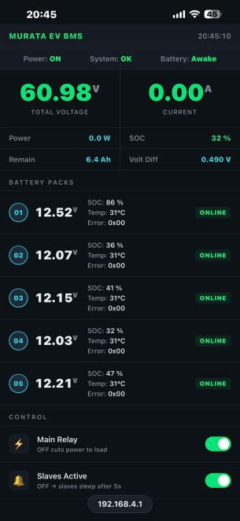
  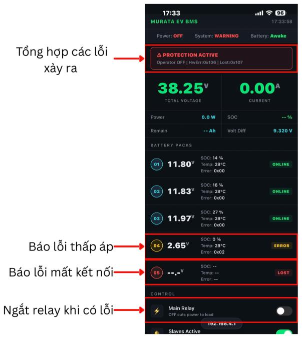
</p>

_Figure 31–32: Normal operation (five batteries online, 60.98 V total, system SOC equal
to the weakest battery) and a fault condition (one battery under-voltage, one lost; all
active reasons listed, relay shown open)_

---

VI. Off-target verification
---------------------------

Beyond the bench, the SOC estimator is tested on a PC.

**Unit tests** — 20 Unity tests, **100 % line and branch coverage** (`gcov`) on
`SOC_Kalman.c`. The harness links **the same source file** that is flashed to the STM32;
there is no second copy that could drift.

**Offline simulation** — `simulate.c` drives a virtual battery with the ECE-15 urban
cycle (UNECE R83) and the DST battery cycle (USABC / INL Battery Test Manual). Vehicle
parameters come from the real general-arrangement drawing: 535 kg laden, 1.93 m² frontal
area. Three estimators run on identical inputs — plain Coulomb counting, a Coulomb + OCV
hybrid, and the production Kalman module.

**Monte Carlo** — 30 noise seeds × 3 configurations. RMSE against the simulator's
ground-truth SOC, in percentage points:

| Configuration | Coulomb counting | **Kalman** |
|---|---|---|
| Ideal start, nominal capacity | 0.47 | 0.45 |
| Unknown initial SOC, 90 % aged capacity, 0.125 A sensor bias | 21.82 | **0.39** |
| Same, DST cycle | 23.71 | **0.28** |

With a correct starting point the two methods are equivalent. Under realistic conditions
— pack aged, sensor biased, initial SOC unknown at power-on — Coulomb counting drifts by
more than 20 percentage points while the filter stays under 0.4. That gap is the entire
reason for the filter.

> These are simulation results against a modelled battery. They show the estimator is
> correct **given the model**; they do not establish SOC accuracy on a physical battery.

---

VII. Limitations
----------------

Stated plainly, because a results table without them is not worth much.

- **Bench only.** The system was never run on a vehicle.
- **Current chain verified below 1 A.** The ±5 % figure is demonstrated at 0.92 A;
  accuracy across the full 0–100 A range is not established.
- **Two fault types physically injected** — under-voltage and lost node. Over-voltage,
  over-temperature and over-current are implemented and configured but were not
  triggered on hardware.
- **Trip latency is partial.** The 8.53 ms covers fault detected → command issued inside
  the microcontroller. It excludes CAN transport delay, the 3 s node timeout, and the
  contactor's mechanical travel.
- **Isolation shown indirectly.** Five floating-ground monitors do share one bus
  successfully, but no insulation resistance or withstand-voltage measurement was made.
- **No cell balancing.** Batteries that drift apart trigger a trip; charge is not
  redistributed.
- **SOC error on a real battery is unknown.** No reference discharge was performed, so
  the model parameters remain datasheet and literature values.
- **No headless build for the monitor firmware.** It builds under STM32CubeIDE only;
  there is no CMake or Makefile, so it cannot be built in CI yet.
- **Relay module under-rated.** Its contacts are rated 30 V DC while switching the
  contactor coil off the 60 V pack (≈0.2 A).

---

VIII. Build and run
-------------------

**Central controller (ESP32)** — PlatformIO:

```bash
cd BMS_Master
pio run -e esp32doit-devkit-v1           # build
pio run -t upload && pio device monitor  # flash + serial
```

**Battery monitor (STM32F103)** — STM32CubeIDE: import `BMS_Slave/`, build, flash over
SWD. Each board is built with a different `SLAVE_INDEX` (0–4), which selects its CAN ID
and its two-point voltage calibration constants.

**Unit tests and coverage** (Git Bash, needs `gcc` and `gcov`):

```bash
cd BMS_Slave/UnitTest
./run.sh cov
```

**Offline simulation:**

```bash
cd BMS_Slave/UnitTest
gcc -std=c11 -I ../Core/Inc sim/simulate.c ../Core/Src/SOC_Kalman.c -o sim/simulate -lm
./sim/simulate 1            # seed -> sim_result.csv
bash sim/monte_carlo.sh     # 30 seeds x 3 configurations
```

---

IX. Code quality
----------------

Both firmwares were brought up to one written standard after the thesis
measurements were finished. The standard is the Innova embedded C (A1–A25) and
C++ (B1–B25) rule set, which is inspired by MISRA C and CERT C. The code is
**not** MISRA-compliant and does not claim to be: no checker runs in the loop,
there is no deviation record, and the vendor HAL under `BMS_Slave/Drivers/` is
excluded from the rules outright.

What is enforced, and how each claim is checked:

| Check | Tool | Result |
|---|---|---|
| File structure — header, guards, section banners | project template validator | **26 / 26** files pass |
| Comment language, non-ASCII bytes in `BMS_Slave/Core` | grep | **0** |
| MISRA C:2012 Rule 8.7, internal linkage | manual audit | 0 violations, 4 documented exceptions |
| STM32 firmware links | `arm-none-eabi-gcc 14.2`, `-Wall -Wextra` | **0 warnings** |
| STM32 sources type-check on the host | `gcc -fsyntax-only -Wall -Wextra` | **16 / 16** clean |
| Kalman filter behaviour | Unity, against the exact file that is flashed | **20 / 20** pass |
| ESP32 firmware links | PlatformIO, Arduino-ESP32 | **0 warnings** |

Footprint, read from the linked images rather than estimated:

| | flash | RAM |
|---|---|---|
| STM32F103C8T6 battery monitor | 22 976 B of 65 536 (35 %) | 2 496 B of 20 480 (12 %) |
| ESP32 central controller | 850 849 B of 1 310 720 (65 %) | 44 444 B of 327 680 (14 %) |

The STM32 image can be reproduced without an IDE:

```bash
cd BMS_Slave
arm-none-eabi-gcc -mcpu=cortex-m3 -mthumb -std=gnu11 -O0 -g3 -Wall -Wextra \
  -ffunction-sections -fdata-sections -DUSE_HAL_DRIVER -DSTM32F103xB \
  -ICore/Inc -IDrivers/STM32F1xx_HAL_Driver/Inc \
  -IDrivers/STM32F1xx_HAL_Driver/Inc/Legacy \
  -IDrivers/CMSIS/Device/ST/STM32F1xx/Include -IDrivers/CMSIS/Include \
  -T STM32F103C8TX_FLASH.ld --specs=nosys.specs -Wl,--gc-sections \
  Core/Src/*.c Drivers/STM32F1xx_HAL_Driver/Src/*.c \
  Core/Startup/startup_stm32f103c8tx.s -o bms_slave.elf
arm-none-eabi-size bms_slave.elf
```

### 9.1 Defects the pass uncovered

Reading every line in order to document it turned up four real defects. None
had shown up in testing, and each is a separate `fix:` commit.

| Defect | Consequence | Why it was never seen |
|---|---|---|
| DS18B20 scratchpad decoded as `uint16_t` instead of `int16_t` | −10 °C reads as **+4086 °C**, raising a false over-temperature fault and opening the contactor | the batteries have never been below 0 °C |
| ADC average divided by the number of samples *requested*, not *converted* | a timed-out conversion counts as 0 V; losing 10 of 100 samples under-reports the voltage by 10 % with no fault flag — and a low reading is exactly what makes under-voltage protection trip | one conversion takes 7 µs against a 2 ms timeout |
| ESP-NOW peer struct left uninitialised | `ifidx` indeterminate, so the peer was registered against whatever happened to be on the stack | the task has not been started since the handheld remote was shelved |
| Fault-reason string shared across cores with no lock | the web page can show a reason spliced from the old text and the new | the write is ~128 bytes against a 500 ms read period |

The same pass also found four comments and one console banner that contradicted
the code — among them an OCV equation with the wrong coefficients, a banner
announcing two lithium packs for a five-battery lead-acid system, and a claim
that the scheduler dropped 11 % of its activations, which it does not.

---

Repository layout
-----------------

```
BMS_Slave/            STM32F103 firmware — battery monitor
  Core/Src, Core/Inc    scheduler, tasks, ADC, DS18B20, CAN, Kalman filter
  UnitTest/             Unity tests, gcov coverage, offline simulation
BMS_Master/           ESP32 firmware — central controller (PlatformIO)
  src, include          FreeRTOS tasks, protection logic, INA219, web server
VCAN_RX_TEST/         Reference CAN decoder handed to the motor-controller team
BENCH_INA219/         Bench characterisation rig for the current sensor
Esp-now/              ESP-NOW handheld remote (legacy, not part of the BMS)
docs/                 Project brief (Vietnamese) and figures
```

Documentation
-------------

- [`docs/PROJECT_BRIEF.vi.md`](docs/PROJECT_BRIEF.vi.md) — design decisions, measured
  numbers and open items, in Vietnamese
- Thesis, chapter 4 — full design, test method and results for this subsystem.
  Figures in this README are taken from it.

License
-------

MIT
